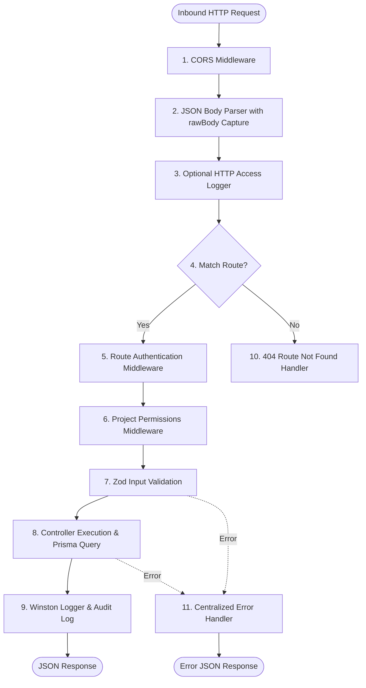

# DevSync — Backend Architecture & Server Mechanics

## 1. Backend Structure & Directory Layout

```
server/src/
├── config/
│   └── db.ts                         # PrismaClient singleton instance with connection pooling
├── controllers/
│   ├── authController.ts             # User registration, login, logout, Google OAuth callback
│   ├── dashboardController.ts        # Aggregated project, task, and activity metrics
│   ├── githubController.ts           # GitHub OAuth, repository link/create, tree/commit DAG, webhooks
│   ├── projectController.ts          # Project CRUD, member management, project-scoped roles
│   ├── taskController.ts             # Task CRUD, status updates, review workflow, reordering
│   └── userController.ts             # User profile listing, role inspection
├── middleware/
│   ├── auth.ts                       # JWT extraction, signature verification, req.user hydration
│   ├── errorHandler.ts               # Centralized handler for Zod, Prisma errors, and HTTP exceptions
│   └── projectPermissions.ts         # Dual-tier project capability authorization checks
├── routes/
│   ├── authRoutes.ts                 # /api/auth routes
│   ├── dashboardRoutes.ts            # /api/dashboard routes
│   ├── githubRoutes.ts               # /api/github routes
│   ├── projectRoutes.ts              # /api/projects routes
│   ├── taskRoutes.ts                 # /api/tasks routes
│   └── userRoutes.ts                 # /api/users routes
├── types/
│   └── index.ts                      # Backend TypeScript types, JwtPayload, AuthenticatedRequest
├── utils/
│   ├── crypto.ts                     # AES-256-GCM token encryption and decryption utilities
│   └── logger.ts                     # Reusable Winston structured real-time activity logger
└── index.ts                          # Express application entry point and server bootstrap
```

---

## 2. Server Entry Point & Middleware Execution Pipeline

The server boots in `server/src/index.ts`. Express executes middleware in strict sequential order:



### Explanation of Middleware Stages:
1. **CORS Middleware (`cors`):** Permits cross-origin requests from the client domain with `credentials: true`.
2. **Body Parser with rawBody Capture:** Standard `express.json()` parses inbound JSON payloads. Crucially, a custom `verify` callback intercepts the unparsed byte buffer:
   ```typescript
   app.use(express.json({
     verify: (req: any, _res, buf) => {
       req.rawBody = buf.toString('utf8');
     }
   }));
   ```
   This ensures that the raw payload string remains available for GitHub webhook HMAC SHA-256 cryptographic signature validation.
3. **Optional HTTP Logger:** Gated behind `process.env.LOG_HTTP === 'true'` to avoid polluting development consoles during routine polling.
4. **Authentication Guard (`server/src/middleware/auth.ts`):** Validates the `Authorization: Bearer <token>` header, decodes the JWT using `process.env.JWT_SECRET`, and attaches `req.user` to the Express request.
5. **Project Permissions Guard (`server/src/middleware/projectPermissions.ts`):** Evaluates the user's project-specific role (`PROJECT_ADMIN`, `PROJECT_LEAD`, `SENIOR`, `DEVELOPER`, `INTERN`) against required capabilities before allowing controller execution.
6. **Controller Logic & Zod Validation:** The controller runs validation schemas (e.g. `taskCreateSchema.parse(req.body)`). If invalid, Zod throws an error caught by the error handler.
7. **Database Interaction:** Executes queries via the Prisma client singleton.
8. **Observability & Response:** Emits structured terminal logs via `logger` and returns the JSON payload.
9. **Error Handling Pipeline:** Any thrown error automatically skips subsequent handlers and invokes `errorHandler`.

---

## 3. Dual-Tier Authorization Model

DevSync separates **Global Application Roles** from **Project-Specific Roles**:

### Global Roles (`UserRole` Enum)
- `ADMIN`: Global system administrator.
- `LEAD`: Organization engineering lead.
- `DEVELOPER`: Standard engineer.
- `INTERN`: Junior apprentice.
- `HR`: Human resources / personnel observer.

### Project Roles (`ProjectRole` Enum) & Capability Matrix
Stored in the `ProjectMember` join table:

| Capability | PROJECT_ADMIN | PROJECT_LEAD | SENIOR | DEVELOPER | INTERN |
|---|---|---|---|---|---|
| `manage_project` | ✅ | ✅ | ❌ | ❌ | ❌ |
| `manage_repository` | ✅ | ✅ | ❌ | ❌ | ❌ |
| `assign_tasks` | ✅ | ✅ | ✅ | ✅ | ❌ (Cannot assign others) |
| `review_tasks` | ✅ | ✅ | ✅ | ❌ | ❌ |
| `approve_work` | ✅ | ✅ | ✅ | ❌ | ❌ |
| `submit_for_review` | ✅ | ✅ | ✅ | ✅ | ✅ |
| `view_team_activity` | ✅ | ✅ | ✅ | ✅ | ✅ |

### Middleware Implementation (`projectPermissions.ts`)
```typescript
export const requireProjectPermission = (capability: keyof typeof ROLE_CAPABILITIES.DEVELOPER) => {
  return async (req: AuthenticatedRequest, res: Response, next: NextFunction): Promise<void> => {
    const projectId = req.params.projectId || req.params.id || req.body.projectId;
    const userId = req.user?.userId;

    const role = await getUserProjectRole(userId, projectId);
    if (!role || !ROLE_CAPABILITIES[role][capability]) {
      res.status(403).json({
        success: false,
        message: `Forbidden: Your project role "${role || 'None'}" lacks "${capability}" permission`,
      });
      return;
    }
    next();
  };
};
```

---

## 4. Centralized Error Handling (`server/src/middleware/errorHandler.ts`)

DevSync catches and normalizes all application exceptions:
1. **Zod Validation Errors:** Returns HTTP `400 Bad Request` with field-level error messages:
   ```json
   {
     "success": false,
     "message": "Validation failed",
     "errors": [{ "field": "email", "message": "Invalid email address" }]
   }
   ```
2. **Prisma Unique Constraint Violation (`P2002`):** Returns HTTP `409 Conflict`:
   ```json
   { "success": false, "message": "Unique constraint failed: A record with this email already exists." }
   ```
3. **Prisma Record Not Found (`P2025`):** Returns HTTP `404 Not Found`.
4. **Prisma Foreign Key Constraint Violation (`P2003`):** Returns HTTP `400 Bad Request`.
5. **Generic Internal Server Errors:** Returns HTTP `500 Internal Server Error` while printing stack traces in development via `logger.error()`.

---

## 5. Real-Time Terminal Activity Logging (`server/src/utils/logger.ts`)

Powered by **Winston**, the logging engine provides colorized, timestamped categorization:
```
[HH:mm:ss] [CATEGORY] Message
```
- Custom ANSI colors: `AUTH` (Cyan), `PROJECT` (Blue), `TASK` (Magenta), `GITHUB` (Yellow), `SYSTEM` (Green), `ERROR` (Red).
- Automatically scrubs sensitive keys (`password`, `passwordHash`, `token`, `accessToken`, `secret`, `authorization`).
- Can be switched to standardized JSON output in production via `NODE_ENV=production`.
