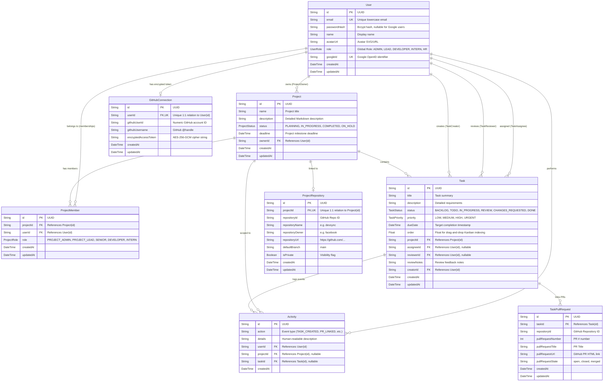

# DevSync — Database Design & Prisma Schema Specification

## 1. Relational Database Overview
DevSync uses **PostgreSQL 16** with schemas defined, migrated, and queried through **Prisma ORM 5.22.0**.
The database schema implements strict relational integrity, 3rd Normal Form (3NF) normalization, declarative cascading deletion policies, and targeted B-tree indexes on foreign keys and frequently queried fields.

---

## 2. Mermaid Entity-Relationship (ER) Diagram



---

## 3. Enumerated Types (Enums)

### `ProjectStatus`
- `PLANNING`: Inception, requirements gathering.
- `IN_PROGRESS`: Actively in development.
- `COMPLETED`: Finished and verified.
- `ON_HOLD`: Temporarily blocked.

### `TaskStatus`
- `BACKLOG`: Unplanned future backlog.
- `TODO`: Ready for development.
- `IN_PROGRESS`: Work underway by assignee.
- `REVIEW`: Work submitted for senior code review.
- `CHANGES_REQUESTED`: Reviewer identified defects or required improvements.
- `DONE`: Approved work or automatically completed via merged GitHub PR.

### `TaskPriority`
- `LOW` | `MEDIUM` | `HIGH` | `URGENT`

### `UserRole` (Global Application Role)
- `ADMIN` | `LEAD` | `DEVELOPER` | `INTERN` | `HR`

### `ProjectRole` (Project-Specific Membership Role)
- `PROJECT_ADMIN`: Full ownership, settings, repo management.
- `PROJECT_LEAD`: Team coordination, assignment, review, approval.
- `SENIOR`: Code review, task approval, change requests.
- `DEVELOPER`: Task execution, self-assignment, submit for review.
- `INTERN`: Task execution, submit for review; cannot assign tasks to others.

---

## 4. Key Relationships & Cascading Deletion Rules

1. **Project Deletion Cascade:**
   `Project` has `onDelete: Cascade` on `members`, `tasks`, `activities`, and `repository`. Deleting a project automatically purges all associated tasks and membership records, preserving referential cleanliness.
2. **Task Deletion Cascade:**
   `Task` has `onDelete: Cascade` on `pullRequests` and `activities`.
3. **Assignee & Reviewer Nullification (`onDelete: SetNull`):**
   `Task.assigneeId` and `Task.reviewerId` reference `User.id` with `onDelete: SetNull`. If a user is deleted from the platform, their assigned tasks remain in the project backlog rather than being deleted, preventing data loss.
4. **Unique Composite Keys:**
   - `ProjectMember`: `@@unique([projectId, userId])` prevents duplicate memberships for the same user in a project.
   - `TaskPullRequest`: `@@unique([taskId, pullRequestNumber])` prevents linking the same GitHub PR to a single task ticket multiple times.

---

## 5. Performance Indexes

| Table | Indexed Columns | Index Purpose |
|---|---|---|
| `User` | `[email]`, `[googleId]` | Instant O(1) B-tree lookup during login and OAuth exchange. |
| `Project` | `[ownerId]`, `[status]` | Fast filtering by project owner and dashboard status aggregations. |
| `ProjectMember`| `[projectId]`, `[userId]` | Fast join queries when checking project permissions. |
| `Task` | `[projectId]`, `[assigneeId]`, `[reviewerId]`, `[status]`, `[priority]` | High-speed Kanban column filtering and user workload counts. |
| `Activity` | `[userId]`, `[projectId]`, `[createdAt]` | Fast sorting and date filtering on the activity timeline. |
| `TaskPullRequest`| `[taskId]`, `[repositoryId]` | Sub-millisecond lookup when matching incoming webhook PR numbers. |

---

## 6. Real Prisma Queries from the Codebase

### A. Updating Kanban Status & Fractional Order
```typescript
// Located in server/src/controllers/taskController.ts
const updated = await prisma.task.update({
  where: { id },
  data: {
    status,
    ...(order !== undefined ? { order } : {}),
  },
  include: TASK_INCLUDE,
});
```
*Generated PostgreSQL:*
```sql
UPDATE "Task"
SET "status" = $1, "order" = $2, "updatedAt" = NOW()
WHERE "id" = $3;
```

### B. Finding and Auto-Completing Tasks via Webhook
```typescript
// Located in server/src/controllers/githubController.ts
const linkedTaskPrs = await prisma.taskPullRequest.findMany({
  where: { pullRequestNumber: prNumber },
  include: { task: true },
});
```
*Generated PostgreSQL:*
```sql
SELECT "TaskPullRequest".*, "Task".*
FROM "TaskPullRequest"
LEFT JOIN "Task" ON "TaskPullRequest"."taskId" = "Task"."id"
WHERE "TaskPullRequest"."pullRequestNumber" = $1;
```

