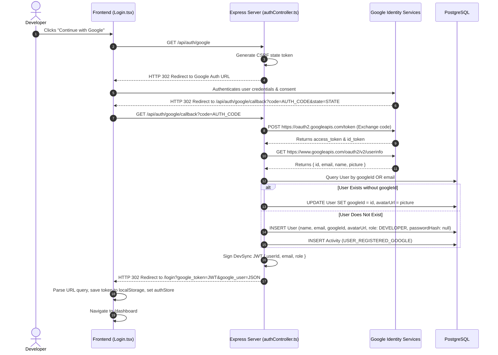

# DevSync — Google OAuth 2.0 Integration & Identity Lifecycle

## 1. Google OAuth 2.0 Overview
DevSync supports Single Sign-On (SSO) via Google OAuth 2.0 using the OpenID Connect (OIDC) specification. This enables users to register and authenticate without maintaining a local password.

---

## 2. Configuration & Credentials

The integration requires credentials from the **Google Cloud Console**:
- **Application Type:** Web application
- **Authorized JavaScript Origins:** `http://localhost:5173`
- **Authorized Redirect URIs:** `http://localhost:5000/api/auth/google/callback`
- **Environment Variables (`server/.env`):**
  - `GOOGLE_CLIENT_ID`: OAuth 2.0 Client ID issued by Google.
  - `GOOGLE_CLIENT_SECRET`: OAuth 2.0 Client Secret.
  - `GOOGLE_CALLBACK_URL`: Target redirect URL (`http://localhost:5000/api/auth/google/callback`).

---

## 3. End-to-End Authentication Sequence



---

## 4. Key Implementation Mechanics

### A. Dual Account Linking Strategy (`server/src/controllers/authController.ts`)
DevSync prevents duplicate accounts by checking both `googleId` and `email`:
```typescript
let user = await prisma.user.findFirst({
  where: {
    OR: [{ googleId: googleUser.id }, { email }],
  },
});
```
- **Scenario 1 (New User):** Creates a new account with `passwordHash: null` and default global role `DEVELOPER`.
- **Scenario 2 (Existing Local Account):** If an engineer registered with `user@example.com` via password and later logs in with Google using that same email address, DevSync automatically links their `googleId` and imports their Google avatar without modifying their existing password hash or role.

### B. Passwordless Account Safety
When a user whose account was created via Google attempts to log in via local email/password, DevSync gracefully prevents unexpected crashes:
```typescript
if (!user.passwordHash) {
  logger.auth(`Failed login attempt: ${validated.email} - account requires Google Sign-In`);
  res.status(400).json({
    success: false,
    message: 'This account was created via Google Sign-In. Please sign in using Google.',
  });
  return;
}
```

### C. Client-Side Hydration (`client/src/pages/Login.tsx`)
On component mount, `Login.tsx` inspects `window.location.search`:
```typescript
useEffect(() => {
  const params = new URLSearchParams(window.location.search);
  const googleToken = params.get('google_token');
  const googleUser = params.get('google_user');

  if (googleToken && googleUser) {
    try {
      const user = JSON.parse(decodeURIComponent(googleUser));
      handleGoogleAuthCallback(googleToken, user);
      navigate('/dashboard', { replace: true });
    } catch (e) {
      setError('Failed to parse Google login response');
    }
  }
}, []);
```
The token is safely extracted, persisted to `localStorage`, and the browser URL is sanitized via `replace: true`.

