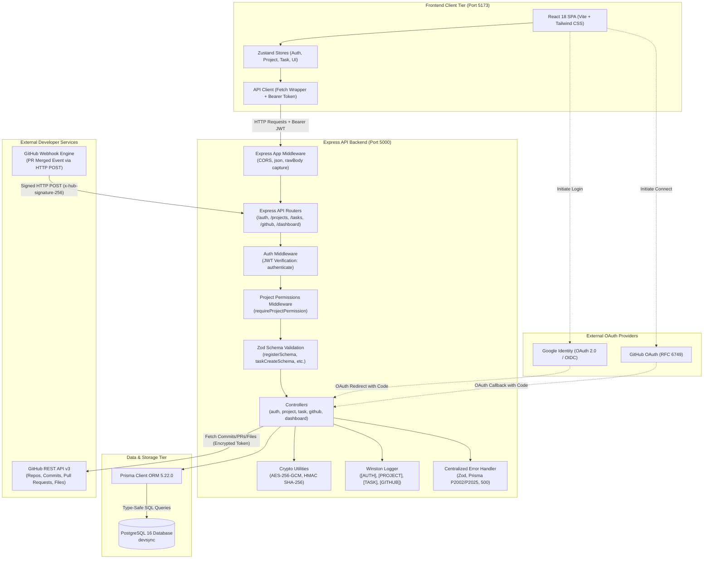
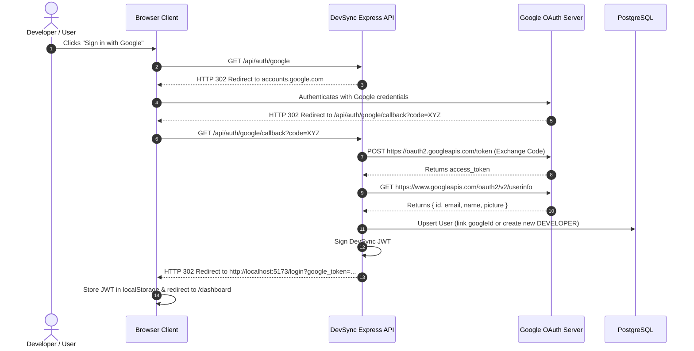
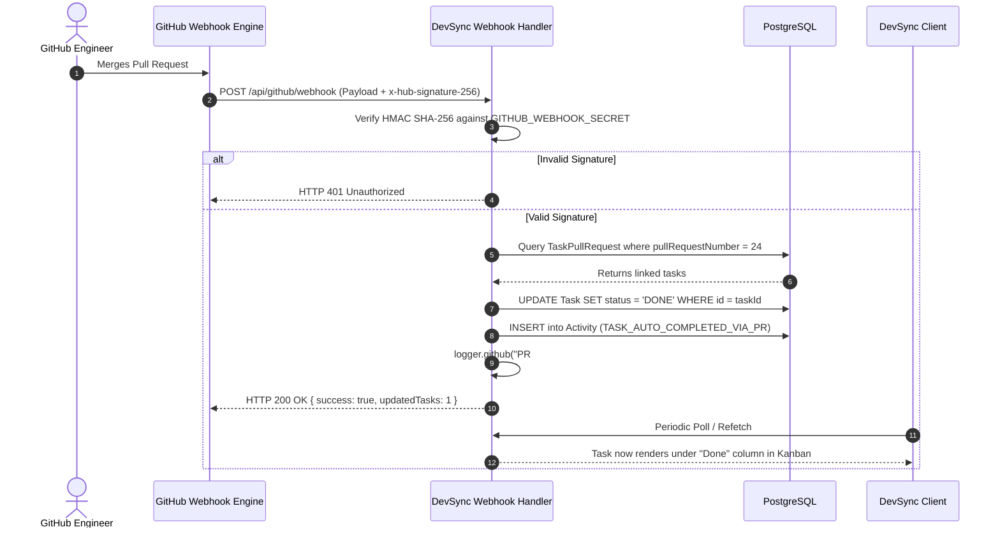

# DevSync — System Architecture & Component Interaction

## 1. High-Level Architecture Overview
DevSync follows a modern, decoupled **Client-Server Architecture** with a single-page application (SPA) frontend, an asynchronous RESTful Express API backend, a PostgreSQL relational database managed via Prisma ORM, and integrations with external OAuth/API providers (GitHub and Google).

### Architectural Characteristics:
1. **Stateless API Tier:** The Express backend does not maintain in-memory HTTP sessions; all authentication relies on self-contained JSON Web Tokens (JWT) transmitted via HTTP Authorization headers.
2. **Encrypted At-Rest Token Storage:** OAuth access tokens issued by GitHub are encrypted using AES-256-GCM before persistence in PostgreSQL.
3. **Decoupled Asynchronous Integrations:** Webhooks from GitHub are verified via cryptographically signed HMAC signatures without exposing sensitive internal endpoints.
4. **Reactive Single-Page Frontend:** Client-side routing with React Router and state hydration with Zustand ensure instant page transitions and local optimistic updates.

---

## 2. Mermaid System Architecture Diagram

---

## 3. End-to-End Request-Response Lifecycle

### A. Internal API Request Lifecycle (Frontend to Database and Back)
1. **User Action & Store Dispatch:** A user takes an action in the UI (e.g., creating a task). A component invokes a store action:
   `useTaskStore.getState().createTask(payload)`
2. **API Client Invocation:** The API client in `client/src/api/client.ts` automatically attaches the active JWT from local storage:
   `headers['Authorization'] = 'Bearer <JWT_TOKEN>'`
3. **CORS & Body Parsing:** Express processes the request in `server/src/index.ts`:
   - `cors()` ensures the request origin is allowed.
   - `express.json()` parses the JSON body while retaining `rawBody` for webhook verification.
4. **Authentication Middleware:** `server/src/middleware/auth.ts`:
   - Extracts and verifies the token using `jwt.verify(token, JWT_SECRET)`.
   - Attaches `req.user = { userId, email, role }` to the Express request object.
5. **Authorization / Permissions Middleware:** `server/src/middleware/projectPermissions.ts`:
   - Evaluates the user's project role against `ProjectMember` in PostgreSQL.
   - Enforces capabilities (e.g., verifying if the user has `assign_tasks` or `review_tasks`).
6. **Input Validation:** The controller invokes Zod:
   `const validated = taskCreateSchema.parse(req.body);`
   If validation fails, execution halts and jumps to `errorHandler`.
7. **Database Transaction via Prisma:** The controller calls Prisma:
   `const task = await prisma.task.create({ data: { ... } });`
   Prisma translates the call into an optimized parameterized PostgreSQL SQL query.
8. **Observability & Logging:** The controller writes an audit record to PostgreSQL (`prisma.activity.create`) and emits an immediate ANSI-colorized log line to the terminal via Winston:
   `logger.task('Task created: "Implement Login" (id: ...)')`
9. **JSON Response Dispatch:** The controller returns `res.status(201).json({ success: true, task })`.
10. **Store State Reactivity:** Zustand receives the response, updates the immutable state tree, and React re-renders only the affected components.

---

## 4. Inbound & Outbound External Request Flows

### B. Google OAuth 2.0 Inbound Flow

---

### C. GitHub Webhook Inbound Flow (PR Auto-Completion)

---

### D. Outbound GitHub REST API Flow (File Explorer & Commit DAG)
1. User navigates to **Code & Repository** tab in Project Details.
2. The frontend requests `GET /api/github/projects/:id/contents?path=src`.
3. The backend retrieves the user's encrypted GitHub token from `GitHubConnection` in PostgreSQL.
4. `crypto.ts` decrypts the token using `AES-256-GCM` and secret key `GITHUB_TOKEN_ENCRYPTION_KEY`.
5. The backend executes an authenticated HTTPS call to `https://api.github.com/repos/{owner}/{repo}/contents/{path}` with header `Authorization: Bearer <GITHUB_TOKEN>`.
6. The backend maps directory trees and file entries and returns them to the frontend without downloading or cloning the entire repository.

